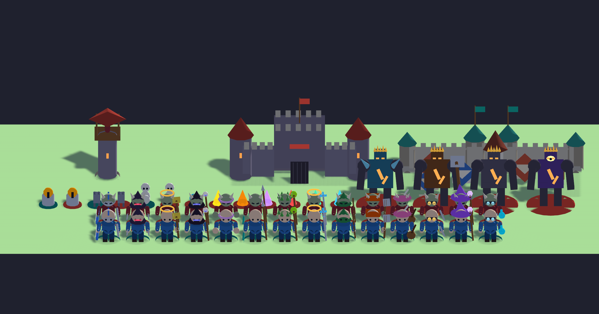

# Blender

Scripts `bpy` que geram os modelos do jogo e exportam para `unity/Assets/Art/`.



## `build_models.py`
Reproduz os modelos procedurais de `js/gl3d.js` (mesmas primitivas, proporções, pivôs, cores e
brilho) e transforma as poses de `pose()` em `js/render.js` em animações.

```
blender -b -P blender/build_models.py              # todos os 48 modelos (~10 s)
blender -b -P blender/build_models.py -- sombra    # só os que contêm "sombra" no nome
```

| Pasta (`unity/Assets/Art/Models/`) | Conteúdo |
|---|---|
| `Units/` | 14 classes × 2 times (`_p` jogador, `_e` inimigo, com chifres e pele verde) |
| `Bosses/` | Colosso, Leviatã, Arconte e Ferreiro |
| `Summons/` | torreta, lobo, esqueleto (2 times), cria das marés e avatar de cada elemento |
| `Structures/` | cidade, fortaleza e torre (sem animação) |

- **Rig**: bones `root` → `torso`, `legL`, `legR`; `torso` → `armL`, `armR`, `head`, nos pivôs do JS.
  Invocações têm só `root` → `body`.
- **Animações** (mesmos tempos do JS): `Idle`, `Walk`, `Stunned`, `Victory` (em loop),
  `Attack` (corpo a corpo ou à distância, arco no Caçador, dois braços nos chefes), `Cast`, `Hit` e `Die`.
- **Cor**: atributo de cor por vértice `Col` (sRGB); o alfa é o brilho emissivo. No Unity o shader
  `ForjaElemental/VertexColorLit` usa esse alfa.
- **Eixos**: frente em +Z e Y para cima no Unity; 1 unidade = 1 casa do tabuleiro.

## No Unity
Depois de gerar, rode **Forja Elemental ▸ Montar modelos** (ou
`unity run unity -- -executeMethod ForjaElemental.EditorTools.ArtPipeline.BuildAll`). Isso cria o
material, o `Boneco.controller` (parâmetros `Speed`, `Stunned`, `Victory` e gatilhos `Attack`,
`Cast`, `Hit`, `Die`), um override por modelo e os prefabs em `Assets/Art/Prefabs/`.
**Forja Elemental ▸ Imagem de conferência dos modelos** renderiza a fileira acima.
