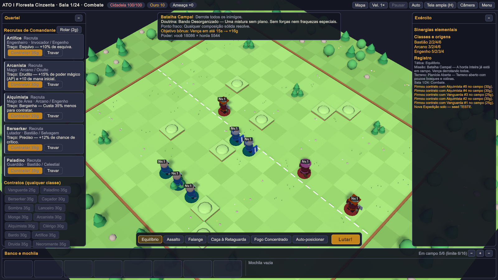
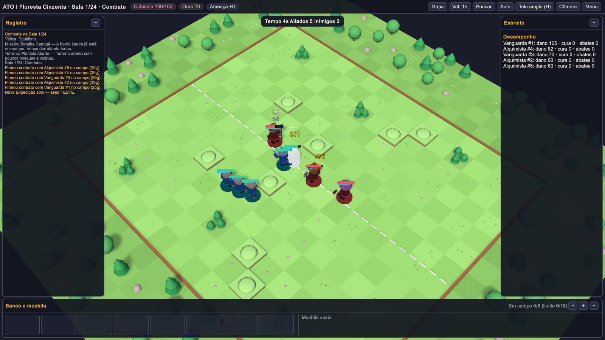
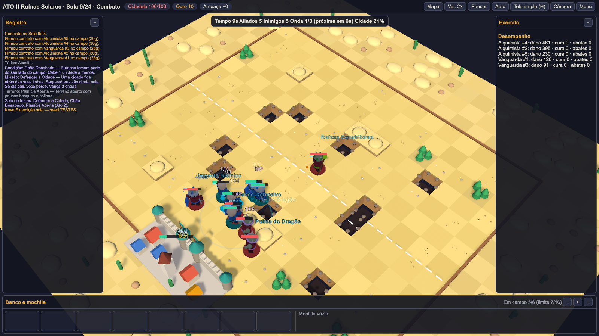
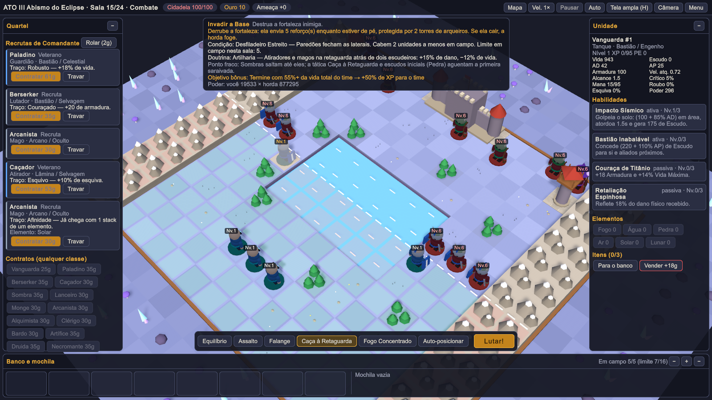

# Unity

Projeto Unity (URP 3D, Unity 6000.6.10f1) do Forja Elemental.

## Estrutura
- `Assets/Scripts/Core/` — motor de regras em C# puro (assembly `ForjaElemental.Core`, sem dependência da Unity):
  - `Js.cs` — `JsMath` (Math.round, Math.hypot e toFixed com a semântica do V8) e `Rng` (mulberry32 de `js/core.js`).
  - `OrderedDict.cs` — dicionário com ordem de inserção (o motor depende da ordem das chaves, como no JS).
  - `GameData.cs` — modelo do conteúdo; `GameData.Load(json)`.
  - `Units.cs` — `UnitDef`, `StatBlock`, `StatsContext`.
  - `StatsCalc.cs` — `computeStats`, `applyMods`, poder (`UnitPower`/`TeamPower`).
  - `Generation.cs` — mapa do Ato, terreno 16×14, hordas e cenários.
  - `Combat.cs` — simulação de combate (`CombatEngine.Create/Update`); efeitos visuais saem por `ICombatFx`.
  - `RunModel.cs` — estado serializável da expedição (`Run`, `Player`, `Pending`, `Meta`...).
  - `Expedition*.cs` — regras da expedição (port de `js/game.js`): Quartel, roster, XP, mapa, cenários,
    escala de poder, inteligência inimiga, objetivos, recompensas, eventos, relíquias e fila de escolhas.
    A interface ouve `OnLog`, `OnToast`, `OnSfx`, `OnChanged`, `OnOpenEvo`.
  - `ExpeditionSim.cs` — simulador headless com a mesma IA de `tests/sim.js`.
  - `SimpleAi.cs` — a IA de `tests/sim.js` (usada pelo simulador e pelo botão **Auto** do jogo).
- `Assets/Scripts/Game/` — o jogo (assembly `ForjaElemental.Game`):
  - `GameController.cs` — liga a expedição ao tabuleiro, bonecos, câmera, HUD e save.
  - `TerrainBuilder.cs` / `MeshKit.cs` — tabuleiro 16×14 e entorno do Ato, gerados em tempo real (port do `gl3d.js`).
  - `BoardView.cs`, `UnitView.cs` (Animator dirigido pelo combate), `CameraRig.cs` (câmera orbital), `CombatFx.cs`.
  - `GameHud.cs` + `Assets/UI/Game/GameHud.uxml/.uss` — HUD em UI Toolkit com painéis recolhíveis.
  - `SaveSystem.cs` — expedição e meta em JSON (`Application.persistentDataPath`).
- `Assets/Scenes/Jogo.unity` — cena jogável (refeita por **Forja Elemental ▸ Montar cena do jogo**).
- `Assets/Scripts/Editor/SimulatorMenu.cs` — menu **Forja Elemental ▸ Simular expedições** e entrada de linha de comando.

## Jogar
Abra `Assets/Scenes/Jogo.unity` e aperte Play. Controles: clique numa unidade sua e depois numa casa
para posicionar; botão direito (ou Shift) + arrastar gira a câmera; roda do mouse dá zoom; setas
giram/inclinam; **H** tela ampla; **M** mapa; **Espaço** pausa; **Esc** limpa a seleção.




### Missões e condições de campo
As quatro missões (Batalha Campal, Reforços Inimigos, Defender a Cidade, Invadir a Base) e as condições
(Dois Andares, Alçapões, Chão Desabado, Desfiladeiro Estreito) vêm do Core e batem com o JS. Na cena:
o briefing mostra ondas, saqueadores, reforços da fortaleza e o limite de campo da sala; no combate a
linha de status mostra a onda (e quando entra a próxima) e a vida da cidade/fortaleza; estruturas
destruídas desabam; ao selecionar uma unidade, as casas válidas ficam verdes (azul = troca, vermelho = bloqueada).

**Sala de testes** (tela inicial / Menu): escolha missão, condição, Ato e tipo de sala e entre direto na
preparação — `Expedition.EnterTestRoom` no Core.



- `Assets/Resources/Data/forja-data.json` — conteúdo exportado de `js/data.js`.
- `Assets/Tests/EditMode/` — testes de paridade com o motor JS (`Golden/*.json`).

## Fluxo
O JS continua sendo a referência de regras. Depois de mudar `js/data.js` ou `js/engine.js`:

```
node tools/export-data.js      # atualiza forja-data.json
node tools/make-golden.js      # regrava os valores de referência do motor
node tools/sim-trace.js        # regrava expedições passo a passo e resumos do sim.js
unity test unity --mode EditMode
unity test unity --mode PlayMode   # abre a cena, joga uma sala e cada missão com a IA; capturas em Logs/Shots
```

Os testes comparam RNG, atributos, mapa, terreno, hordas, combates completos, expedições inteiras
(estado a cada passo) e a saída do simulador com o JS. Uma divergência aponta o primeiro ponto em
que o port difere.

Simulador C# (mesmos argumentos e mesma saída de `node tests/sim.js <runs> <asc> <jogadores> <escala> [tática|dumb]`):

```
unity run unity -- -executeMethod ForjaElemental.EditorTools.SimulatorMenu.RunFromCommandLine -simArgs "30 0 1 dinamica"
```
